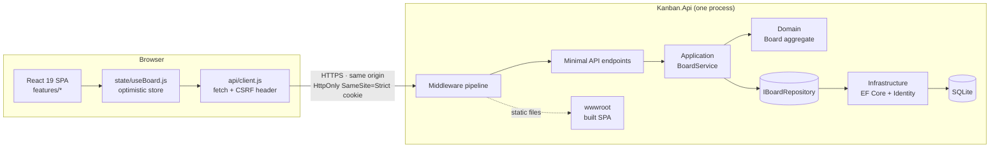
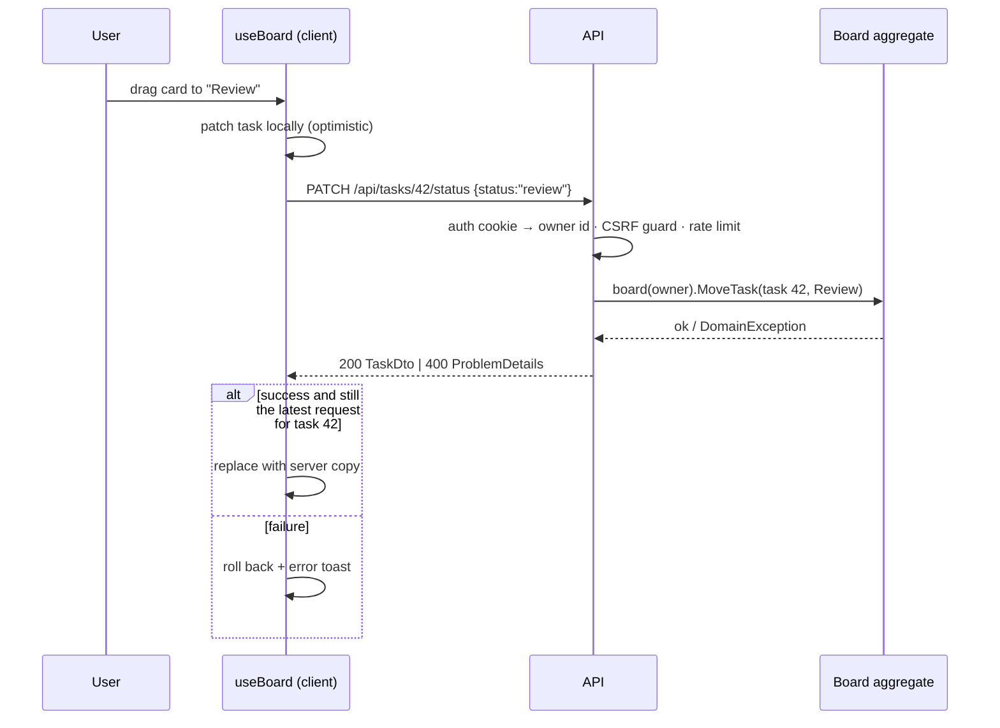

# Architecture

Kanban Studio is a single deployable: an ASP.NET Core 10 API that also serves the React SPA from its `wwwroot`. The browser only ever talks to **one origin**, which is what makes the cookie-based security model simple and strong (see [SECURITY.md](SECURITY.md)).



## Backend: Clean Architecture

Dependencies point inward only. The domain knows nothing about HTTP or EF Core.

| Project | Responsibility | Depends on |
|---|---|---|
| `Kanban.Domain` | The `Board` aggregate (`SprintTask`, `Subtask`, `BoardMember`), every invariant and limit (`Rules`), `DomainException` | nothing |
| `Kanban.Application` | Use cases (`BoardService`), wire contracts (DTOs), allow-list parsing (`WireFormat`), onboarding seed, `Result<T>` | Domain |
| `Kanban.Infrastructure` | `KanbanDbContext` (EF Core + ASP.NET Identity), `BoardRepository`, migrations | Application |
| `Kanban.Api` | Host, middleware, endpoints, auth, rate limiting, static SPA | Infrastructure |
| `Kanban.Tests` | Domain unit tests and HTTP integration tests through the real pipeline | Api |

### Why a single aggregate

A board, with its members, tasks and subtasks, is loaded and saved as one unit, and every lookup is keyed by **owner id**. Consequences:

- **No IDOR by construction.** There is no "get task by id" query. A task is found *inside the caller's board*, so another user's id simply isn't there and returns 404.
- **Invariants live in one place.** "The assignee must be a member", "points must be Fibonacci" and "at most 50 subtasks" are enforced in `Board`/`SprintTask`, so the API layer can't forget them.
- **Size is bounded.** `Rules.TasksPerBoardMax = 500` keeps the aggregate cheap to load. If boards ever outgrow that, split tasks into their own aggregate with an owner-scoped query.

### Request lifecycle: moving a card



### Persistence

- EF Core 10 on SQLite (`App_Data/kanban.db`). Members and subtasks are **owned collections** with explicit `Position` columns, because relational stores don't preserve list order.
- Migrations live in `Kanban.Infrastructure/Persistence/Migrations` and run at startup (`Database:MigrateOnStartup`, default `true`).
- To switch to PostgreSQL, SQL Server or MySQL, replace `UseSqlite` in `Infrastructure/DependencyInjection.cs`, add the provider package and regenerate migrations. Nothing else changes.

## Frontend

```
web/src
├── App.jsx                 session check → AuthScreen | Workspace
├── api/client.js           the ONLY place that calls fetch; explicit request field allow-list
├── state/useBoard.js       reducer + optimistic mutations, rollback, undo-able deletes
├── hooks/                  useHotkeys, useTheme, useHashView (view in URL hash)
├── lib/                    meta.js (labels, sorting), options.jsx (dropdown option sets)
├── ui/                     Icon system, Select (glass listbox), Dialog, Toasts, Bits
├── features/
│   ├── auth/               sign in / sign up
│   ├── shell/              Workspace, Sidebar, Toolbar, People & Shortcuts dialogs
│   ├── board/              BoardView → Column (inline composer) → TaskCard
│   ├── table/              List view (lazy-loaded)
│   ├── analytics/          Insights view (lazy-loaded)
│   └── task/               TaskInspector, NewTaskDialog
└── styles/                 tokens → base → glass → app → product → controls
```

### State model

- **The server is the source of truth.** The client keeps the last board the server returned, plus optimistic edits on top of it.
- **Per-task request sequencing.** `useBoard` numbers each mutation per task, and only the newest reply may overwrite local state. A slow, older PUT can never clobber a newer edit.
- **Inspector drafts.** The inspector keeps a local draft. Discrete controls save immediately; text saves after a 600 ms pause; anything pending is flushed on close.
- **Undo-able deletes.** A card disappears at once and the DELETE is sent after 5 s unless undone. If the tab closes first, it is sent with `fetch(..., { keepalive: true })`.

### Performance choices

| Choice | Effect |
|---|---|
| `React.memo` on `Column`, `TaskCard` and table rows, with stable callbacks | A move re-renders only the two affected columns' changed cards |
| One-pass grouping and counting (`useMemo`) | No `filter()` per column per render |
| `useDeferredValue` on search | Typing never blocks on filtering |
| `content-visibility: auto` on cards | Off-screen cards skip layout and paint |
| Lazy `TableView` and `AnalyticsView` | The board's initial JS stays small |
| Glass only on the chrome layer | No `backdrop-filter` per card, a large GPU saving |
| System font stack | No web-font download, no layout shift |
| Hashed assets cached `immutable`; `index.html` `no-cache` | Instant repeat loads; deploys still picked up |
